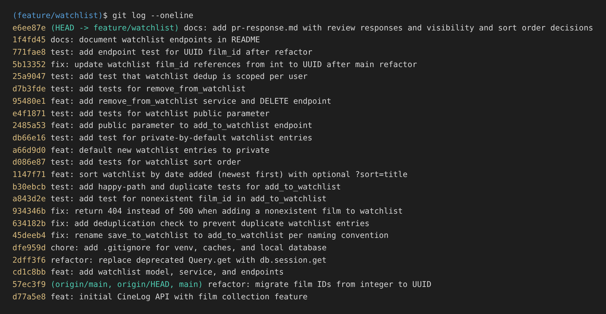

# PR Response Doc: CineLog Watchlist Feature

Branch: `feature/watchlist` → `main`
Response to @dev-lead's review (6 comments) plus three stretch features.

---

## AI Usage

I used Claude (Anthropic) throughout this project. Here's specifically what for, and what I verified myself:

- **Codebase orientation.** Before reading the review, I had Claude summarize `models.py`, `services/collection_service.py`, and `tests/test_collection.py`, and walk through `add_to_collection()` step by step: what it checks, in what order, and what it raises. I checked that summary against the code. The order matters (film-exists check first, then duplicate check), and I kept that order in `add_to_watchlist()`.
- **Spotting the dead `public` flag.** While talking through Comment 4, we traced every read of `WatchlistEntry.public` and found that nothing filters on it. `GET /watchlist/<user_id>` returns private entries too, and CineLog has no auth. That finding is the core of my Comment 4 argument.
- **Implementation and tests.** Claude drafted the code changes and tests with me, one commit per change. For each new test I checked it **fails on the old code**, not just that it passes on the new code. Two examples: the nonexistent-film test fails when the `Film` lookup is removed, and the sort-order test fails against the original alphabetical query. One of the first sort tests we wrote couldn't tell date order from alphabetical (both gave the same answer for its data), so we threw it out and rebuilt it with films where the two orders disagree.
- **Stress-testing Comments 4 and 5.** For each position I asked "what would a careful reviewer push back with?" On Comment 4 that surfaced the cold-start concern (a private default means less community signal), which is now the acknowledged tradeoff. On Comment 5 it surfaced "a watchlist is a queue, so shouldn't it be oldest-first?", which I address directly.
- **Commit hygiene.** I checked the final `git log --oneline` against the Conventional Commits spec and CONTRIBUTING.md's "one logical change per commit" rule. That's why the 404 fix for nonexistent films is split out from the dedup commit, and every test commit is separate from its code commit.

Commits made in this session carry a `Co-Authored-By: Claude` trailer.

---

## Comment 1: Rename

**What I did:**
Renamed `save_to_watchlist()` to `add_to_watchlist()` in `services/watchlist_service.py` and updated its docstring ("Save a film…" → "Add a film…"). CONTRIBUTING.md says service functions use a `verb_to_noun` pattern and lists `add_to_collection()`, `remove_from_collection()`, and `get_collection()` as the models. `save_to_watchlist` broke that: the same action is called "add" everywhere else, so anyone who knows the collection API would guess the wrong name. The stretch function follows the same pattern (`remove_from_watchlist`).

**How I verified:**
- I ran a project-wide search with `grep -rn "save_to_watchlist" --include=*.py .` before the change. It found three hits: the definition, the import in `routes/watchlist/watchlist.py`, and the call in `add_film()`.
- I ran the same search after the change and got zero hits.
- `pytest tests/ -v` passed, and `python app.py` imports cleanly. An import-time `ImportError` from a missed call site would show up there, because `create_app()` imports the watchlist blueprint.

Commit: `fix: rename save_to_watchlist to add_to_watchlist per naming convention`

---

## Comment 2: Deduplication

**Pattern I followed: `add_to_collection()` in `services/collection_service.py`.**
`add_to_collection()` runs two checks in order before it writes anything:
1. **The film must exist.** It calls `db.session.get(Film, film_id)` and raises `FilmNotFoundError` if that returns `None`.
2. **The film must not already be there.** It looks for an existing `CollectionEntry` with the same **`user_id` and `film_id` pair** (`filter_by(user_id=..., film_id=...).first()`). If one exists it raises `AlreadyInCollectionError` instead of inserting, and the route turns that into **HTTP 409 Conflict**.

The model backs this up at the database level with `UniqueConstraint("user_id", "film_id", name="unique_user_film_collection")`.

**What I did:**
I mirrored each piece for the watchlist:
- I added `AlreadyInWatchlistError`, named to match `AlreadyInCollectionError`.
- In `add_to_watchlist()`, after the existing film check, I query `WatchlistEntry.query.filter_by(user_id=user_id, film_id=film_id).first()` and raise `AlreadyInWatchlistError` if it finds a row.
- I added `UniqueConstraint("user_id", "film_id", name="unique_user_film_watchlist")` to `WatchlistEntry`. The app-level check gives a clean error message, and the constraint guarantees no duplicates even if two requests race past the check.
- The `POST /watchlist/<user_id>/add` route now catches `AlreadyInWatchlistError` and returns **409**, the same as the collection route.

**Related bug, separate commit:** while reading the route I noticed it never caught `FilmNotFoundError`. Adding a nonexistent film returned **500** instead of **404**. I fixed that to match `routes/collection.py`, but in its own commit, because it's a different bug from duplicates.

**How I verified:**
- I added `test_add_to_watchlist_duplicate_raises`. It adds the same film twice, asserts the second call raises `AlreadyInWatchlistError`, and asserts exactly **one** row exists afterward.
- I tested manually with curl against a seeded DB: the first add returns `201`, the repeat returns `409 {"error": "Film '…' is already on this user's watchlist"}`, and a nonexistent film returns `404`.
- I added the stretch test `test_same_film_on_two_users_watchlists` to confirm the check is scoped to the **pair**, not to `film_id` alone (see Stretch section).

Commits:
- `fix: add deduplication check to prevent duplicate watchlist entries`
- `fix: return 404 instead of 500 when adding a nonexistent film to watchlist`

---

## Comment 3: Missing test

**What I did:**
I created `tests/test_watchlist.py` with `test_add_to_watchlist_nonexistent_film_raises`, modelled directly on `test_add_to_collection_nonexistent_film_raises` in `tests/test_collection.py`:
- **Same fixtures:** `app` (in-memory SQLite, `create_all`/`drop_all` around each test), `sample_user`, and `sample_film`, copied so the file stands alone the same way `test_collection.py` does.
- **Same structure:** everything inside `with app.app_context():`, with the all-zeros UUID `"00000000-0000-0000-0000-000000000000"` as the fake ID.
- **Same assertion:** `pytest.raises(FilmNotFoundError)`.

I added one assertion the collection test doesn't have: that **no `WatchlistEntry` was written**. Raising the right error isn't enough if a row gets written first.

CONTRIBUTING.md also asks for a happy-path test and a duplicate test for every new service function, so I added `test_add_to_watchlist_creates_entry` and `test_add_to_watchlist_duplicate_raises` in a separate commit. They also mirror their collection counterparts.

**How I verified:**
- `pytest tests/test_watchlist.py -v` passes.
- **I checked that the test can actually fail.** I temporarily disabled the `if film is None` check in `add_to_watchlist()` and re-ran it, and it failed. SQLite doesn't enforce foreign keys by default, so without the check the bad row is silently inserted. That's exactly the bug the test exists to catch. Then I restored the check.

Commits:
- `test: add test for nonexistent film_id in add_to_watchlist`
- `test: add happy-path and duplicate tests for add_to_watchlist`

---

## Comment 4: Default visibility

**My position:** Change the default from `public=True` to **`public=False`** (private unless the user opts in). I also added an explicit `public` parameter to the add endpoint so clients can opt in per film.

**Reasoning:**

The most important thing I found while working on this comment: **nothing in CineLog reads `public` yet.** `get_watchlist()` returns every entry, `GET /watchlist/<user_id>` is open to anyone who has the user ID, and the app has no authentication. So today the flag changes nothing. That makes this question less about current behavior and more about **what we promise users before the feature that enforces it exists.**

That's why the default matters now and not later. Once someone builds the obvious next feature (a friend's or profile watchlist view that filters on `public`), every row already in the table becomes visible or hidden based on a default nobody chose. With `public=True`, every film a user saved before that feature shipped would be exposed retroactively, with no prompt. With `public=False`, launching sharing exposes nothing users didn't explicitly opt into.

The watchlist also means something different from the collection. In CineLog the **collection is the social record**: it holds ratings, and those ratings feed `Film.average_rating`, which is community data by design. The **watchlist is intent.** It's "things I haven't watched yet": the Oscar bait you feel you *should* see, the horror film you're working up to, the thing a date recommended. People save to it in a single tap (`POST /add` takes only a `film_id`), so the add flow never presents a visibility choice. **The default effectively is the decision for almost every entry.**

So the costs are asymmetric:
- **If private is wrong**, a user's list is less visible than they'd like. They notice, they flip it, and nothing is lost.
- **If public is wrong**, the information is already out. Making it private afterwards doesn't un-show it.

When one mistake can be undone and the other can't, the default should be the undoable one.

**Tradeoff acknowledged:**
This costs CineLog community signal, and CineLog *is* a community app. Public watchlists drive discovery ("3 people you follow want to watch *Blade Runner*") and give a new app content to show early. Private-by-default means most watchlists will stay private because most people never change defaults, so any future "trending on watchlists" feature starts with a much smaller pool. It also diverges from the collection, which has no visibility control at all and is effectively public.

I think that cost is worth paying, and it can be reduced without changing the default:
1. **Explicit opt-in is now supported.** `POST /watchlist/<user_id>/add` accepts `"public": true` (stretch feature below). A frontend can offer a "share this" toggle, or a per-user "make my watchlist public" setting can pass `true` on every add.
2. **Aggregate signals don't need individual exposure.** "142 people want to watch this" can be computed across all entries, private ones included, without showing *whose* lists they're on. Most of the discovery value survives.

**Follow-up I'm flagging, not fixing here:** because nothing enforces `public`, `GET /watchlist/<user_id>` currently returns private entries to anyone. Fixing that needs a notion of "who's asking", which needs auth, and that's out of scope for this PR. I'd suggest an issue, so the flag isn't mistaken for a privacy guarantee before then.

Commits:
- `feat: default new watchlist entries to private`
- `test: add test for private-by-default watchlist entries`

---

## Comment 5: Sort order

**My position:** I'm adopting your preference. The default is now **date added, newest first**. I'm keeping alphabetical as an **opt-in** (`GET /watchlist/<user_id>?sort=title`) instead of dropping it.

**Reasoning:**
I originally sorted by title because I pictured the watchlist as a **lookup list**: someone asks "is *Zodiac* on my list?" and you scan alphabetically. Your review changed my mind for three reasons:

1. **Consistency with `get_collection()`.** The collection already returns `date_added.desc()`, and its test (`test_get_collection_returns_newest_first`) treats that as a contract. Two list endpoints on the same user, built from the same shape of model, shouldn't sort differently by default. A client rendering both would have to special-case one of them.
2. **The common action is "what did I just add?"** Watchlist adds happen in the moment: a trailer, a friend's recommendation, a review you just read. The most common next step is confirming it landed or picking from what's fresh in your mind. Alphabetical buries a just-added *Paddington 2* in the middle of the list.
3. **Lookup is better solved by search than by sort.** Alphabetical only helps lookup if you scroll to the right letter. A title filter (like `/films/`'s `?genre=`) would serve "is X on my list?" better, and doesn't have to dictate the default order.

**Engagement with reviewer's point:**
You wrote that *"most users want to see what they added recently."* I agree, and CineLog's own data model backs it up. A watchlist entry stores nothing but `film_id`, `date_added`, and `public`. There's no rating, priority, or note, so `date_added` is the only signal the list carries about the user's intent, and an alphabetical default throws it away. Your point also matches how the add flow works: one-tap adds from a trailer or a friend's rec mean the newest entries are the ones the user is most likely to come back for. Where I'd push a little is on dropping alphabetical entirely. As watchlists grow, people do want to browse them by name, and `?sort=title` costs one `if` in the service. The parameter is validated against an explicit whitelist (`WATCHLIST_SORTS`), and an unknown value returns **400** instead of silently falling back. That way a typo like `?sort=titel` is visible to the caller.

I also considered **oldest-first** (treat the watchlist as a FIFO queue: watch what's been waiting longest). I went with newest-first because it matches the collection, and because a long-lived watchlist read oldest-first opens on films the user saved months ago and may have lost interest in. If the queue reading is what you had in mind, flipping `.desc()` to `.asc()` is a one-line change, and I'm happy to do it.

**How I verified:**
`test_get_watchlist_returns_newest_first` uses films where **date order and alphabetical order disagree**: *Alien* added five days ago, *Blade Runner* added now. It inserts the newer entry first so that insertion order can't produce a false pass either. Against the original alphabetical query this test **fails**; against the new code it passes. There are also tests for `sort="title"` and for invalid sort values.

Commits:
- `feat: sort watchlist by date added (newest first) with optional ?sort=title`
- `test: add tests for watchlist sort order`

---

## Comment 6: Rebase

**What conflicted:**
While the PR was open, `57ec3f9 refactor: migrate film IDs from integer to UUID` landed on `main`. It changed `Film.id` and every `film_id` foreign key from `db.Integer` to `db.String(36)`. My branch's first commit had changed the **same line** of `WatchlistEntry` to add an index:

```
<<<<<<< HEAD (main)
    film_id = db.Column(db.String(36), db.ForeignKey("film.id"), nullable=False)
=======
    film_id = db.Column(db.Integer, db.ForeignKey("film.id"), nullable=False, index=True)
>>>>>>> (feature/watchlist) added watchlist model and endpoint...
```

That was the only textual conflict. All 17 later commits replayed cleanly.

**How I resolved it:**
`git fetch origin` then `git rebase origin/main`. I resolved the conflict by **combining both sides**, not picking one: main's `db.String(36)` type plus my branch's `index=True`. Taking main's line alone would silently drop the index, and taking mine would reintroduce an integer FK pointing at a UUID primary key.

```python
film_id = db.Column(db.String(36), db.ForeignKey("film.id"), nullable=False, index=True)
```

The resolution is folded into the commit being replayed, so after the rebase I made a **separate** commit for the UUID cleanup that git *couldn't* detect. These references weren't textual conflicts, but they were still wrong:
- `services/watchlist_service.py`: the docstring said `film_id (int): ID of the film. (Note: integer — pre-refactor)`, changed to `film_id (str): UUID of the film.`
- `routes/watchlist/watchlist.py`: the documented request body said `{"film_id": <int>}`, changed to `{"film_id": "<uuid>"}`. This is the API contract clients read, so it matters more than a code comment.

**How I verified no conflict remains:**
- `grep -rn "<<<<<<<\|>>>>>>>" .` finds no conflict markers.
- `grep -rni "int>\|(int)\|integer\|pre-refactor" services routes tests` finds no remaining integer film-ID references in watchlist code. The only `Integer` columns left are `Film.year` and `CollectionEntry.rating`, which are meant to be integers.
- `test_add_endpoint_accepts_uuid_film_id` posts a real UUID string through `POST /watchlist/<user_id>/add` and asserts a `201` with the same 36-character `film_id` echoed back. Every fixture film now gets a UUID from `generate_uuid()`, so the whole watchlist suite exercises UUIDs.
- `pytest tests/ -v` passes: **17 passed**.
- `git log --merges origin/main..HEAD` is empty, so there are **no merge commits**, and `git log --graph` is a straight line from `main`.

Commits:
- `fix: update watchlist film_id references from int to UUID after main refactor`
- `test: add endpoint test for UUID film_id after refactor`

---

## Commit history rewrite

The branch came with two commits:
- `added watchlist model and endpoint fixed a bug more changes`. That's three changes in one message with no type prefix; CONTRIBUTING.md lists "added watchlist", "fixed a bug", and "more changes" word-for-word as **not acceptable**.
- `fix: update film retrieval method to use db.session.get in collection and watchlist services`. It's conventional, but it isn't a fix: swapping the deprecated `Query.get()` for `db.session.get()` changes no behavior.

With `git rebase -i HEAD~19` I marked both as `reword`:
- → `feat: add watchlist model, service, and endpoints`
- → `refactor: replace deprecated Query.get with db.session.get`

The commits I added were written one logical change each, with code and its tests always in separate commits as CONTRIBUTING.md asks. None needed squashing.

### `git log --oneline`



*(Taken on `feature/watchlist` after the rebase and rewrite. The final commit, which adds this screenshot file, is necessarily not in its own screenshot.)*

---

## Stretch features

### 1. `remove_from_watchlist(user_id, film_id)`
Mirrors `remove_from_collection()` exactly. It looks up the `(user_id, film_id)` entry, raises a new `NotInWatchlistError` (named to match `NotInCollectionError`) if there is none, otherwise deletes the entry and returns `True`. It's exposed as `DELETE /watchlist/<user_id>/remove` with body `{"film_id": "<uuid>"}`: `200` on success, `404` if the film isn't on the list, `400` if `film_id` is missing. These are the same codes as the collection route.
Tests: `test_remove_from_watchlist_deletes_entry` and `test_remove_from_watchlist_not_on_list_raises`.

### 2. Extra edge-case test: dedup is scoped per user
`test_same_film_on_two_users_watchlists` has two different users add the same film and asserts both succeed (two rows for that `film_id`).
**Why this case:** the dedup check and the `UniqueConstraint` both have to cover the **pair** `(user_id, film_id)`. A tempting mistake, especially since `film_id` now has `index=True`, is a unique constraint or `filter_by` on `film_id` alone. That would pass every single-user test (happy path, duplicate, nonexistent) and then break the app the moment a second person saves a popular film. None of the requested tests involve two users, so none of them would catch it.

### 3. Visibility toggle
`POST /watchlist/<user_id>/add` accepts an optional `"public": true|false`, which defaults to `false` (see Comment 4) and is passed through to `add_to_watchlist(user_id, film_id, public=False)`. The route rejects anything that isn't a JSON boolean with **400**. That matters: `"public": "false"` is a non-empty string and therefore truthy in Python, so accepting it naively would make an entry **public** when the user asked for the opposite. `test_add_endpoint_rejects_non_boolean_public` covers exactly that case and asserts nothing was written.

---

## PR Description

### What this does
Adds a **watchlist** to CineLog: a per-user list of films you want to watch, separate from your collection of films you've already logged. Users can add a film (optionally marking it public), view their watchlist, and remove films. A film can be on a given user's watchlist only once.

### Endpoints
| Method | Endpoint | Body / params | Responses |
|---|---|---|---|
| GET | `/watchlist/<user_id>` | `?sort=date_added` (default, newest first) or `?sort=title` | `200`, `400` bad sort |
| POST | `/watchlist/<user_id>/add` | `{"film_id": "<uuid>", "public": false}` | `201`, `400`, `404` unknown film, `409` duplicate |
| DELETE | `/watchlist/<user_id>/remove` | `{"film_id": "<uuid>"}` | `200`, `400`, `404` not on list |

### Design decisions
1. **Visibility defaults to private (`public=False`).** The add flow is one tap with no visibility prompt, so the default effectively decides for almost every entry. Nothing enforces `public` yet, so private-by-default means a future sharing feature can't retroactively expose lists users never chose to share. Users opt in with `"public": true`. Tradeoff: less community/discovery signal. See Comment 4.
2. **Sort order is date added, newest first**, matching `get_collection()`, with `?sort=title` as an opt-in alphabetical view. See Comment 5.
3. **Duplicates are rejected** with `409`, following `add_to_collection()`, and enforced at the DB level with a `(user_id, film_id)` unique constraint.

### Known limitation
`public` is stored but not yet enforced on reads. `GET /watchlist/<user_id>` returns private entries, because CineLog has no auth. I suggest a follow-up issue.

### How to test manually
```bash
# 1. Setup
python -m venv .venv && source .venv/bin/activate
pip install -r requirements.txt
rm -f cinelog.db instance/cinelog.db   # start fresh; the schema changed
python seed.py                          # prints the demo user_id
python app.py                           # serves on http://127.0.0.1:5000

# 2. In a second terminal, grab IDs
export U=<user_id printed by seed.py>
curl -s localhost:5000/films/            # copy two film "id" values
export A=<Alien's id>  B=<Spirited Away's id>

# 3. Add (private by default) → 201, "public": false
curl -s -X POST localhost:5000/watchlist/$U/add -H 'Content-Type: application/json' -d "{\"film_id\":\"$A\"}"

# 4. Add a second film as public → 201, "public": true
curl -s -X POST localhost:5000/watchlist/$U/add -H 'Content-Type: application/json' -d "{\"film_id\":\"$B\",\"public\":true}"

# 5. Duplicate → 409
curl -s -X POST localhost:5000/watchlist/$U/add -H 'Content-Type: application/json' -d "{\"film_id\":\"$A\"}"

# 6. Nonexistent film → 404
curl -s -X POST localhost:5000/watchlist/$U/add -H 'Content-Type: application/json' -d '{"film_id":"00000000-0000-0000-0000-000000000000"}'

# 7. View: newest first → Spirited Away, then Alien
curl -s localhost:5000/watchlist/$U
#    Alphabetical → Alien, then Spirited Away
curl -s "localhost:5000/watchlist/$U?sort=title"

# 8. Remove → 200; remove again → 404
curl -s -X DELETE localhost:5000/watchlist/$U/remove -H 'Content-Type: application/json' -d "{\"film_id\":\"$A\"}"
curl -s -X DELETE localhost:5000/watchlist/$U/remove -H 'Content-Type: application/json' -d "{\"film_id\":\"$A\"}"

# 9. Automated tests → 17 passed
pytest tests/ -v
```
> If you already had a `cinelog.db` from before the UUID refactor, delete it. `db.create_all()` won't migrate an existing table from integer to UUID IDs.
